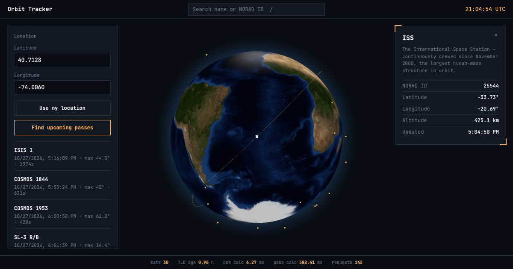

# Orbit Tracker

Live satellite tracking and pass prediction on an interactive 3D globe, built on public orbital data.

**Live demo: https://orbit-tracker-coral.vercel.app**



Orbit Tracker fetches current orbital elements (TLEs) from CelesTrak, propagates them with SGP4 to get each satellite's real-time position, and renders up to 30 satellites on a globe that updates every 5 seconds. Select a satellite to see its orbit path and details, or enter a location to get a list of upcoming passes overhead.

## Features

- **Live orbital data.** 5 curated satellites (ISS, Hubble, NOAA-18, NOAA-19, GOES-16) plus about 25 more from CelesTrak's "visual" group, each validated with the TLE line checksum before use.
- **Real-time positions.** Latitude, longitude and altitude for every tracked satellite, computed with Skyfield's SGP4 implementation.
- **Pass prediction.** For any ground location: rise time, maximum elevation and duration of each pass above a minimum elevation (default 10 degrees).
- **Orbit paths.** Selecting a satellite draws its path over one full orbital period, with the camera framed to fit it. Geostationary satellites get a special case (see below).
- **Search and navigation.** Find satellites by name or NORAD ID, with keyboard navigation. Selecting one flies the camera to it. Press `/` to focus search and `Esc` to close the details panel.
- **Use my location.** Optional browser geolocation fills in your coordinates, and the last location is remembered locally.
- **Live stats bar.** Satellites tracked, TLE cache age, calculation times and request count, measured by the running backend.
- **Mobile layout.** Bottom sheets for passes and details, touch-friendly tap targets, custom touch hit-testing for the small satellite markers, and reduced-motion support.

## Tech stack

| Layer | Technology |
|---|---|
| Orbital mechanics | Skyfield (SGP4) |
| Backend | Python 3.14, Flask |
| Data source | CelesTrak GP data API |
| Frontend | Vanilla JavaScript, globe.gl 2.46.2 (three.js) |
| Hosting | Vercel (Flask as a single Vercel Function, static files from `public/`) |

No frontend build step and no npm dependencies.

## How it works

- `tle_data.py` fetches and validates TLEs (curated satellites by NORAD ID, extras in one request from the "visual" group) and caches them for 24 hours.
- `positions.py` builds Skyfield satellite objects and computes positions and orbit paths.
- `passes.py` finds rise, culmination and set events for an observer location using Skyfield's event search.
- `app.py` exposes everything as a small JSON API.
- `public/` holds the frontend, which polls the API and renders it with globe.gl.

Orbit paths are sampled in 60 steps across one period (taken from the mean motion field of the TLE) and cached per satellite for an hour.

## Metrics

Measured on this project. Timings are from local runs on a laptop, not on Vercel, and are rounded.

| Metric | Result |
|---|---|
| Satellites tracked | 30 (5 curated + 25 from the bulk group) |
| TLE checksum validation | No failures in the runs logged |
| TLE fetch, 5 satellites, 5 separate requests (cold) | 2.43 s |
| Position calculation, 5 satellites | 1.24 ms |
| Position calculation, 30 satellites | 7.1 to 7.6 ms (observed) |
| Pass prediction, 5 satellites, 5-day window | 106.6 ms, 84 passes found |
| Pass prediction, 30 satellites, 3-day window | 475 to 514 ms (observed) |

Position cross-checks against known orbital data:

- ISS: computed altitude of 419 to 422 km, in line with its maintained altitude of roughly 400 to 420 km.
- GOES-16: computed altitude of 35,779 to 35,788 km across readings, against a theoretical geostationary altitude of about 35,786 km.
- Hubble: 468 to 469 km. NOAA-18 and NOAA-19: 856 to 874 km, the expected range for polar weather satellites.
- Pass behavior is consistent with orbital geometry. From New York, Hubble's maximum elevation peaked at 12.3 degrees in the 5-day sample, as expected for an orbit inclined at 28.5 degrees. GOES-16 produces no passes, because it holds a fixed position in the sky and never rises or sets.

## Run it locally

Requires Python 3.10 or newer (developed on 3.14).

```bash
git clone https://github.com/ttarkhani/orbit-tracker.git
cd orbit-tracker
python3 -m venv venv
source venv/bin/activate      # Windows: venv\Scripts\activate
pip install -r requirements.txt
python app.py
```

The API runs at `http://127.0.0.1:5000`. In a second terminal, serve the frontend:

```bash
cd public
python3 -m http.server 8000
```

Open `http://localhost:8000`. On localhost the frontend talks to the API on port 5000. When deployed, both share one origin.

## API

| Endpoint | Description |
|---|---|
| `GET /api/satellites` | Current position of every tracked satellite |
| `GET /api/passes?lat=X&lon=Y&min_elevation=10&days=5` | Upcoming passes over a location |
| `GET /api/orbit-path?name=ISS` | One full orbit path for a satellite |
| `GET /api/stats` | Live backend stats: calculation times, TLE cache age, requests served |
| `GET /api/health` | Health check |

`/api/orbit-path` takes the satellite name as a query parameter rather than a URL segment, because some names contain slashes (for example `SL-14 R/B`).

## Project structure

```
app.py            Flask app and API routes
positions.py      Satellite positions and orbit paths
passes.py         Pass prediction
tle_data.py       TLE fetching, validation and caching
requirements.txt
public/           Frontend: index.html, style.css, app.js
test_*.py         Manual check scripts
```

## Deployment notes

The Flask app runs as a single Vercel Function and the frontend is served as static files from `public/`. Because the filesystem is read-only except for `/tmp`, the TLE cache is written to `/tmp` when running on Vercel. That cache does not survive a cold start and is not shared between instances, so a cold instance re-fetches TLEs from CelesTrak, and the stats bar shows numbers for whichever instance served the request.

## Problems solved along the way

- **Skyfield and NumPy.** `skyfield==1.46` failed on import with NumPy 2, because it relied on `numpy.float_`, which was removed. Fixed by upgrading to Skyfield 1.55.
- **Geostationary orbits.** A geostationary satellite's ground track is almost a single point, so sampling latitude and longitude over one period draws nothing useful. The path code detects periods close to one sidereal day and adds Earth's rotation back into the sampled longitudes, which reveals the real ring.
- **Tiny, unclickable markers.** The globe library picks click targets from a periodic hover check, so quick taps on small markers could miss. Touch input now uses its own hit test: the nearest visible satellite within 22 px, ignoring satellites on the far side of the globe.
- **Framing the orbit.** The camera distance comes from the camera's field of view and the space left free by open panels, instead of a fixed zoom, so both a low orbit and a geostationary ring fit on screen at any window size.
- **Scaling from 5 to 30 satellites.** Extra satellites come from one request to CelesTrak's "visual" group rather than one request each. Extrapolating the measured 2.43 s for 5 requests, 30 separate requests would take roughly 15 s on a cold start.
- **Read-only serverless filesystem.** The TLE cache moves to `/tmp` on Vercel, and cache write failures are non-fatal.

## Known limitations

- Passes are geometric (satellite above the elevation threshold). They do not account for whether the satellite is sunlit or the sky is dark.
- Only about 30 satellites are tracked. The extra 25 come from CelesTrak's "visual" group and can change as that group is updated.
- The first request after a period of inactivity is slower, because a cold instance loads NumPy and re-fetches TLEs.
- Stats shown in the UI are per running instance and reset when it restarts.
- SGP4 predictions are most accurate within about a week of the TLE epoch.
- The `test_*.py` files are manual check scripts, not an automated test suite.

## Credits

Orbital data from [CelesTrak](https://celestrak.org). Orbit propagation by [Skyfield](https://rhodesmill.org/skyfield/). Globe rendering by [globe.gl](https://github.com/vasturiano/globe.gl). Earth texture from the three-globe examples.
